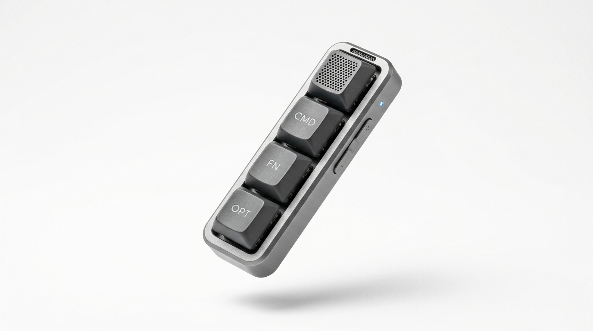
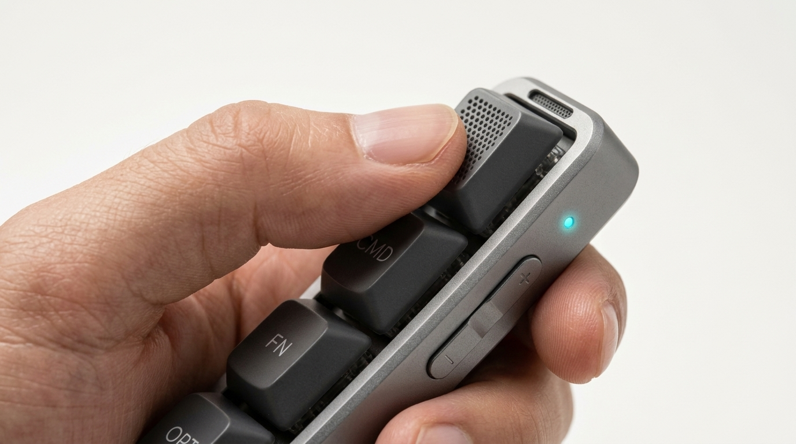
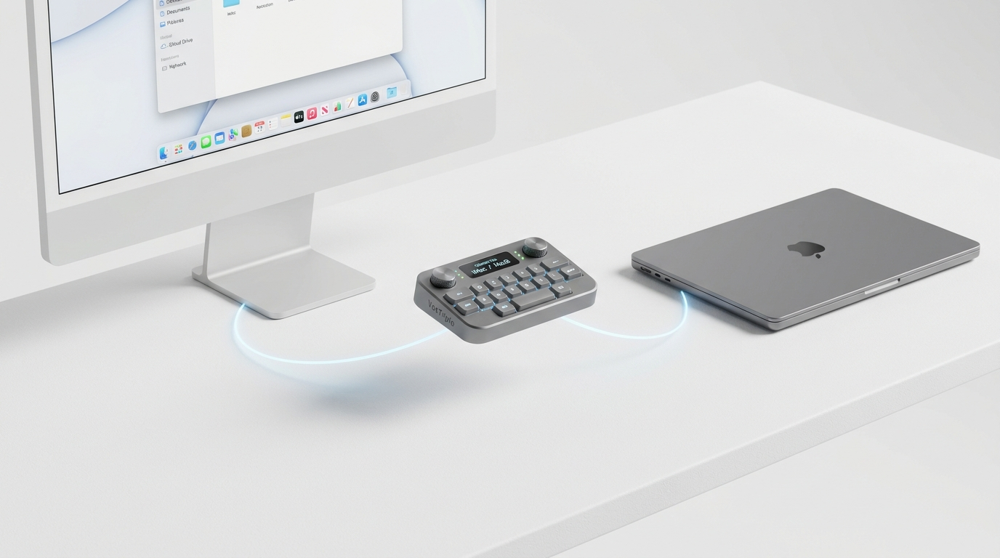
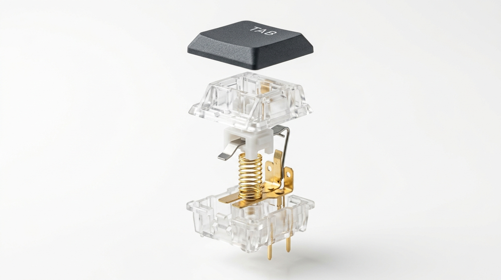
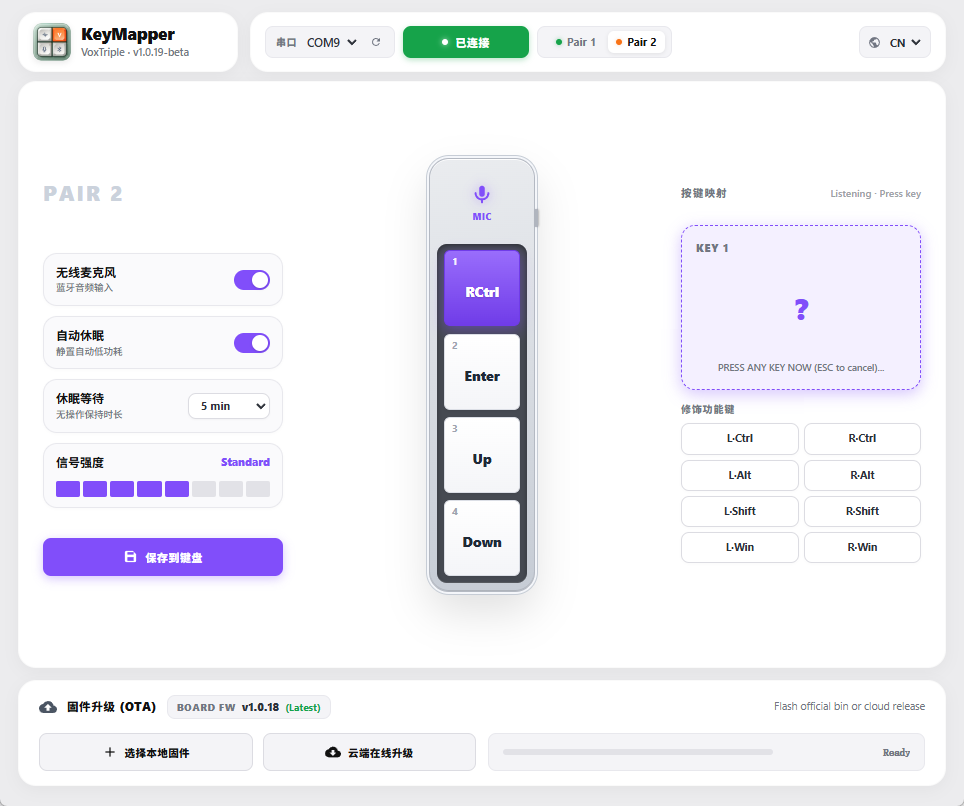
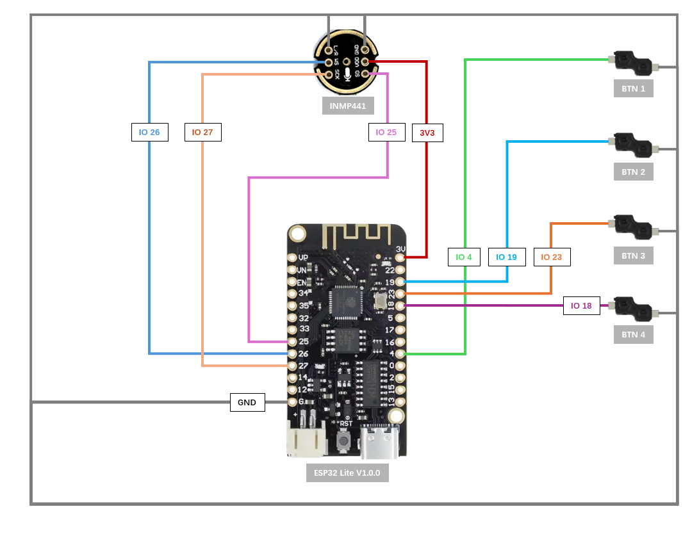

<div align="center">

# VoxTriple 🎙️⌨️
### ESP32 蓝牙手持语音输入机械终端<br/>Handheld Bluetooth Voice-to-Text Mechanical Terminal

[](https://github.com/elementchen/VoxTriple/releases/latest)
[](LICENSE)
[](https://github.com/elementchen/VoxTriple)
[](https://docs.espressif.com/projects/esp-idf/en/stable/esp32/index.html)
[](https://www.python.org/)

<br/>

**专为台式机电脑（普遍无内置麦克风）与 AI 时代 Prompt 密集输入打造的随身手持机械语音终端。**<br/>
*An ergonomic, handheld Bluetooth mechanical input terminal built for desktop PCs and high-frequency AI prompt workflows.*

<br/>



</div>

<br/>

---

## 💡 为什么需要 VoxTriple？/ Why VoxTriple?

随着 ChatGPT、Claude、DeepSeek、Cursor 等 AI 生产力工具的全面普及，日常工作与编程中的 **Prompt 输入量爆发式增长**：

* ❌ **打字速度瓶颈**：键盘打字速度通常仅有 50 ~ 80 字/分钟，长时间键入极易导致指关节与手腕疲劳；
* ❌ **台式机无麦痛点**：绝大多数台式机 PC 均没有内置麦克风，戴着笨重闷热的头戴耳机交谈体验沉重；
* ❌ **会议麦克风占桌面**：传统桌面麦克风容易喷麦、收集周围键盘杂音且不可移动。

🎯 **VoxTriple 的解法**：
1. **拿起来即说，松开即发送**：配合 Windows 原生语音（`Win + H`）或 macOS 原生听写，文字产出速度飙升至 **200 ~ 300 字/分钟**，思考即刻转化为 Prompt，文字生产力瞬间提升 300%！
2. **客制化机械键盘手感**：内置 4 颗清脆段落客制化机械矮轴，实体按键的确认感与反馈极致扎实，支持盲操盲打。
3. **免驱蓝牙复合双模**：系统级原生免驱识别为经典蓝牙 HID 键盘 + HFP 高清免提麦克风复合设备，无缝兼容 Windows、macOS 与 Linux。

<br/>

---

## ✨ 核心特性矩阵 / Key Features

<div align="center">

| 🎧 声学微孔导音仓 | 🔀 物理双主机无缝切换 |
| :---: | :---: |
|  |  |
| **手感比口红更便携**<br/>18.5 × 29.8 × 102.0 mm 极致圆润握持，指向性微孔导音腔体，抗噪防喷麦 | **物理两档开关瞬间对齐**<br/>侧边硬件拨动开关（GPIO 33），Mac 与 PC 双工作台秒级热切换 |

| ⌨️ 客制化机械矮轴 | 🤖 离线与在线 AI 对话提速 |
| :---: | :---: |
|  |  |
| **清脆段落触感与 PBT 键帽**<br/>微动式机械段落轴体，毫秒级按压反馈，按住说话、一键回车、快捷换行 | **300字/分钟 思考即输入**<br/>无缝衔接本地离线大模型或云端 AI 工具，彻底告别双手键盘输入疲劳 |

</div>

<br/>

---

## 🖥️ 官方上位机配套软件 / KeyMapper Companion App

VoxTriple 配备全自研的现代化桌面配置中心（**Windows 原生免安装单文件绿色程序**），支持所见即所得的改键与硬件管理：

<div align="center">
  
  <p><em>全新一代 1:1 仿真铝合金机身交互界面 · 左右对称修饰键对照 · 动态芯片 MAC 广播名呈现</em></p>
</div>

### 🌟 上位机核心亮点：
* **1:1 拟物铝合金机身**：中间真实呈现设备按键布局，轻击按键即可完成改键或麦克风开关联动。
* **左右成对修饰键排布**：`[L·Ctrl / R·Ctrl]`、`[L·Alt / R·Alt]`、`[L·Shift / R·Shift]`、`[L·Win / R·Win]` 左右两列工整呼应，支持单键复合绑定。
* **芯片真实广播名实时嗅探**：自动从 ESP32 底层回包解析带有物理 MAC 末位的真实广播名（如 `ESP32_BT_KBD_MIC_2C`），并在设备正下方纯净文字优雅展示。
* **20秒闪电串口 OTA 升级**：自带固件升级模块，可直接选择本地 `.bin` 文件或通过在线云端升级，20 秒内直刷完成自动软重启。
* **多语言即时切换**：内置国际化中英文双语内核，自动探测操作系统语言并支持一键热切换。

<br/>

---

## 🚀 极速下载与开箱上手 / Quick Start

### 📥 1. 下载最新发行包 (Release Assets)

前往 [👉 GitHub Releases 页面](https://github.com/elementchen/VoxTriple/releases/latest) 下载最新发布的成品物料：

| 物料文件 | 用途说明 |
| :--- | :--- |
| **`VoxTriple_v1.0.19.exe`** | **Windows 上位机客户端**：免安装绿色版，下载双击即开，管理按键映射与升级 |
| **`esp32_bt_mic_merged_v1.0.19.bin`** | **ESP32 首次烧录全量合包**：内含 Bootloader、分区表与 OTA 初始化数据，首偏置地址填 `0x0` |
| **`esp32_bt_mic_v1.0.19.bin`** | **ESP32 日常 OTA 增量固件**：日常在上位机点击“固件升级”直接加载刷入 |

---

### ⚡ 2. 硬件接线指南 (Wiring Diagram)

VoxTriple 基于乐鑫标准 ESP32 模组与 I2S MEMS 声学微孔麦克风模组构建：

<div align="center">
  
</div>

#### 引脚映射参考表：

| 外部传感器 / 按键组件 | 引脚标识 | ESP32 GPIO 端口 | 功能说明 |
| :--- | :--- | :--- | :--- |
| **I2S 拾音传感器** | **VDD** | **3.3V** | ⚠️ **严禁接 5V！请务必接入 3.3V 供电** |
| | **GND** | **GND** | 电源共地 |
| | **L/R** | **GND** | 硬件配置为左声道采集 |
| | **SD (Serial Data)** | **GPIO 17** | I2S 音频串行数据总线 |
| | **WS (Word Select)** | **GPIO 22** | 声道时钟 (LRC / WS) |
| | **SCK (Serial Clock)** | **GPIO 21** | 串行位时钟 (BCLK / SCK) |
| **4 × 机械轴体按键** | **Key 1 (PTT 语音键)** | **GPIO 4** | 按住说话 / 松开静音（默认映射：`RCtrl`） |
| | **Key 2 (操作发送键)** | **GPIO 18** | 一键回车发送 / 快捷确认（默认映射：`Enter`） |
| | **Key 3 (功能上翻键)** | **GPIO 19** | 光标 / 菜单上翻（默认映射：`Up`） |
| | **Key 4 (功能下翻键)** | **GPIO 23** | 光标 / 菜单下翻（默认映射：`Down`） |
| **两档物理拨动开关** | **Host Slot Switch** | **GPIO 33** | 硬件物理切换双电脑主机配对（低电平: Slot 0 / 高电平: Slot 1） |
| **状态指示灯** | **Status LED** | **GPIO 16** | 状态指示（低电平点亮，PTT 按住讲话时同步常亮） |

> 📌 *注：所有机械按键均启用 ESP32 内部上拉电阻（Active Low，引脚接按键后直通 GND 即可），接线无需任何外部上下拉电阻。*

---

### 💻 3. 开发者编译与固件构建 (Developer Guide)

如果您希望自行定制固件功能或本地二次开发：

```powershell
# 1. 激活乐鑫官方 ESP-IDF 5.5 环境
$env:IDF_PATH="C:\Espressif\frameworks\esp-idf-v5.5.1"
. C:\Espressif\Initialize-Idf.ps1

# 2. 进入固件目录并编译
cd esp32_bt_mic
idf.py build

# 3. 烧录固件到开发板 (使用 115200 保证高阻抗走线信号稳定性)
idf.py -p COM5 -b 115200 flash
```

#### 上位机源码本地运行：
```powershell
cd windows_app_python
pip install -r requirements.txt
python vox_triple.py
```

<br/>

---

## 📂 项目工程架构 / Repository Structure

```text
VoxTriple/
├── esp32_bt_mic/                  # [ESP32 嵌入式固件] (基于 ESP-IDF 5.5 + Bluedroid 经典蓝牙复合栈)
│   ├── CMakeLists.txt
│   ├── partitions.csv             # 双 OTA 分区与 NVS 存储配置表
│   ├── sdkconfig.defaults         # 经典蓝牙 HID 键盘 + HFP 免提协议栈共存优化默认配置
│   └── src/
│       ├── main.c                 # 系统初始化入口与任务调度
│       ├── bt_init.c              # 经典蓝牙栈拉起、MAC 动态广播名命名与 GAP 控制
│       ├── bt_hfp_hf.c            # HFP Client 协议与 SCO 宽带语音传输
│       ├── classic_hidd.c         # 经典蓝牙 HID 键盘描述符注册与按键上报
│       ├── multi_host.c           # 双主机槽位管理与 GPIO 33 物理拨动开关驱动
│       ├── button_handler.c       # 按键消抖、PTT 语音触发与自动休眠策略
│       ├── config_cmd.c           # 串口配置协议解析器 (cJSON)
│       ├── config_storage.c       # NVS 永久存储 (键位映射/主机配置/休眠参数)
│       └── uart_console.c         # 串口有线通信驱动与 20秒高速 OTA 升级引擎
│
├── windows_app_python/            # [Windows 桌面客户端] (PyQt5 + 现代化 Web 前端架构)
│   ├── vox_triple.py              # 主进程与本地 Web API 服务网桥
│   ├── spp_client.py              # 串口异步数据包通信引擎与固件 OTA 直传流控
│   ├── VoxTriple_v1.0.19.spec     # PyInstaller 独立绿色版打包配置
│   └── web/                       # 现代化 1:1 仿真铝合金机身 Web 前端界面
│       ├── index.html
│       ├── style.css
│       └── app.js
│
├── docs/                          # [项目设计与规范文档]
│   ├── images/                    # 高清产品渲染实拍图、架构图与接线指南
│   ├── PROJECT_CONTEXT_MEMORY.md  # 项目全局记忆备忘录与设计哲学
│   └── flash_guide_zh.md          # 详细图文小白烧录指引
│
├── AGENTS.md                      # AI 协作规范与 GitHub 提交边界防守准则
└── LICENSE                        # MIT 开源许可证
```

<br/>

---

## 📜 许可证 / License

本项目采用 [MIT 许可证](LICENSE) 开源发布。无论是个人 DIY、爱好者改制还是商业化衍生，均可自由使用。

欢迎提交 Issue 和 Pull Request，共同打造更加极致的 AI 随身输入硬件体验！

<div align="center">
  <sub>Designed with ❤️ for AI Creators & Mechanical Keyboard Enthusiasts</sub>
</div>
